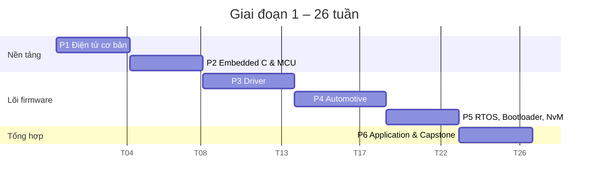

# Roadmap: Trở thành Automotive Embedded Engineer

Roadmap tổng thể chia làm 4 giai đoạn: **nền tảng → chuyên sâu → kinh nghiệm thực tế → chuyên gia**.

```
 ┌──────────────────────────────┐
 │ GĐ 1. NỀN TẢNG (6 tháng)     │  automotive-firmware-knowledge/
 │ Điện tử → C/MCU → Driver →   │
 │ Automotive → RTOS/Boot → App │
 └──────────────┬───────────────┘
                │  Hoàn thành Capstone "Mini Body Control ECU"
                ▼
 ┌──────────────────────────────────────────────────────────────────────┐
 │ GĐ 2. CHUYÊN SÂU – chọn 1 hướng chính (+1 hướng phụ)  specializations/│
 │                                                                      │
 │  01 AUTOSAR BSW/MCAL      02 Diagnostics/Bootloader/OTA              │
 │  03 Functional Safety     04 Cybersecurity                           │
 │  05 Networks/Ethernet     06 Motor Control/EV                        │
 │  07 Adaptive AUTOSAR/HPC  08 Test & Validation/HIL                   │
 └──────────────┬───────────────────────────────────────────────────────┘
                │  4–6 tháng / hướng
                ▼
 ┌──────────────────────────────┐      ┌──────────────────────────────┐
 │ GĐ 3. KINH NGHIỆM THỰC TẾ    │ ───► │ GĐ 4. CHUYÊN GIA             │
 │ Đi làm ở OEM/Tier 1, dự án   │      │ Architect, Safety/Security   │
 │ thật, quy trình ASPICE       │      │ Manager, Technical Lead      │
 └──────────────────────────────┘      └──────────────────────────────┘
```

| Giai đoạn | Thời gian (tham khảo) | Thư mục | Kết quả |
|---|---|---|---|
| 1. Nền tảng | Tháng 1–6 | [automotive-firmware-knowledge/](automotive-firmware-knowledge/) | Đủ kiến thức cho vị trí Junior Embedded/Automotive SW |
| 2. Chuyên sâu | Tháng 7–12 (hướng chính), tháng 13–18 (hướng phụ) | [specializations/](specializations/) | Có chuyên môn rõ ràng và portfolio cho hướng đó |
| 3. Thực tế | Năm 2–4 | – | Kinh nghiệm dự án ECU thật, đến lúc SOP |
| 4. Chuyên gia | Năm 5+ | – | Senior, Architect, Manager |

---

# Giai đoạn 1 – Nền tảng (26 tuần)

Mỗi tuần khoảng **10–15 giờ**, 60% thực hành và 40% lý thuyết. Đánh dấu `[x]` vào các mốc để theo dõi tiến độ.



## Phase 1 – Điện tử cơ bản (Tuần 1–4)

| Tuần | Đọc | Thực hành |
|---|---|---|
| 1 | [01-circuit-basics](automotive-firmware-knowledge/00-electronics-fundamentals/01-circuit-basics.md) | Lab E1, E2, E4 ([labs](automotive-firmware-knowledge/00-electronics-fundamentals/labs.md)) |
| 2 | [02-semiconductors](automotive-firmware-knowledge/00-electronics-fundamentals/02-semiconductors.md), [03-digital-logic](automotive-firmware-knowledge/00-electronics-fundamentals/03-digital-logic.md) | Lab E5 (MOSFET + flyback) |
| 3 | [04-power-electronics](automotive-firmware-knowledge/00-electronics-fundamentals/04-power-electronics.md), [05-signals-and-measurement](automotive-firmware-knowledge/00-electronics-fundamentals/05-signals-and-measurement.md) | Lab E3, E6, E7 |
| 4 | [06-schematic-and-pcb](automotive-firmware-knowledge/00-electronics-fundamentals/06-schematic-and-pcb.md) | Lab E9, E10 |

- [ ] Tính được cầu phân áp đo Vbat cho ADC
- [ ] Giải thích được pull-up, decoupling cap, diode flyback
- [ ] Có file `pin_mapping.md` cho board đang dùng

## Phase 2 – Embedded C & MCU (Tuần 5–8)

| Tuần | Đọc | Thực hành |
|---|---|---|
| 5 | [03-embedded-c](automotive-firmware-knowledge/02-firmware/03-embedded-c.md) | Lab C1–C4 ([host_modules](automotive-firmware-knowledge/05-labs-projects/code/host_modules/)) |
| 6 | [01-mcu-architecture](automotive-firmware-knowledge/02-firmware/01-mcu-architecture.md) | Đọc chương GPIO + RCC trong Reference Manual |
| 7 | [02-startup-and-linker](automotive-firmware-knowledge/02-firmware/02-startup-and-linker.md) | Lab M1 ([baremetal_blink](automotive-firmware-knowledge/05-labs-projects/code/baremetal_blink/)) |
| 8 | [08-coding-standards](automotive-firmware-knowledge/01-automotive-fundamentals/08-coding-standards.md), [07-debug-and-test](automotive-firmware-knowledge/02-firmware/07-debug-and-test.md) | Lab M9 (HardFault), cppcheck MISRA |

- [ ] Nháy LED bằng register, startup code và linker script tự viết
- [ ] Debug được bằng GDB/OpenOCD, tìm được dòng gây HardFault
- [ ] Viết unit test trên PC cho một module

## Phase 3 – Driver (Tuần 9–13)

| Tuần | Đọc | Thực hành |
|---|---|---|
| 9 | [01-driver-design-principles](automotive-firmware-knowledge/03-drivers/01-driver-design-principles.md), [02-gpio-and-interrupts](automotive-firmware-knowledge/03-drivers/02-gpio-and-interrupts.md) | Lab M2 |
| 10–11 | [03-timer-pwm-adc](automotive-firmware-knowledge/03-drivers/03-timer-pwm-adc.md) | Lab M3, M5, M6 |
| 12 | [04-uart-spi-i2c](automotive-firmware-knowledge/03-drivers/04-uart-spi-i2c.md) | Lab M4, M7 |
| 13 | [06-clock-power-watchdog](automotive-firmware-knowledge/03-drivers/06-clock-power-watchdog.md) | Lab M8 |

- [ ] Có bộ driver riêng (GPIO, Timer, PWM, ADC, UART, SPI, WDG), không dùng HAL
- [ ] Ứng dụng chạy trên scheduler 1/10/100 ms, có CLI qua UART

## Phase 4 – Automotive (Tuần 14–18)

| Tuần | Đọc | Thực hành |
|---|---|---|
| 14 | [01-vehicle-ee-architecture](automotive-firmware-knowledge/01-automotive-fundamentals/01-vehicle-ee-architecture.md), [02-in-vehicle-networks](automotive-firmware-knowledge/01-automotive-fundamentals/02-in-vehicle-networks.md) | Lab A1, A2 |
| 15 | [05-can-driver](automotive-firmware-knowledge/03-drivers/05-can-driver.md) | Lab A3, A4 |
| 16 | [03-diagnostics-uds-obd](automotive-firmware-knowledge/01-automotive-fundamentals/03-diagnostics-uds-obd.md) | Lab A5, A6 |
| 17 | [04-autosar](automotive-firmware-knowledge/01-automotive-fundamentals/04-autosar.md) | Lab A9 |
| 18 | [05-functional-safety](automotive-firmware-knowledge/01-automotive-fundamentals/05-functional-safety.md), [06-cybersecurity](automotive-firmware-knowledge/01-automotive-fundamentals/06-cybersecurity.md), [07-development-process](automotive-firmware-knowledge/01-automotive-fundamentals/07-development-process.md) | Lab A10 |

- [ ] CAN driver và UDS server chạy trên MCU, kiểm tra bằng `python-udsoncan`
- [ ] Vẽ được luồng `Can → CanIf → PduR → Com → RTE → SWC`
- [ ] Giải thích được ASIL, FFI, SecOC, V-Model

## Phase 5 – RTOS, Bootloader, NvM (Tuần 19–22)

| Tuần | Đọc | Thực hành |
|---|---|---|
| 19 | [04-rtos-and-osek](automotive-firmware-knowledge/02-firmware/04-rtos-and-osek.md) | Lab M10 |
| 20 | [06-memory-and-nvm](automotive-firmware-knowledge/02-firmware/06-memory-and-nvm.md) | Lab C7 |
| 21–22 | [05-bootloader-and-flashing](automotive-firmware-knowledge/02-firmware/05-bootloader-and-flashing.md) | Lab A8 |

- [ ] Dữ liệu NvM không mất khi rút điện giữa lúc ghi
- [ ] Nạp được firmware mới qua CAN

## Phase 6 – Application & Capstone (Tuần 23–26)

| Tuần | Đọc | Thực hành |
|---|---|---|
| 23 | [01-application-architecture](automotive-firmware-knowledge/04-application/01-application-architecture.md), [02-state-machines](automotive-firmware-knowledge/04-application/02-state-machines.md) | Lab C6 |
| 24 | [03-signal-processing-control](automotive-firmware-knowledge/04-application/03-signal-processing-control.md), [04-diagnostic-application](automotive-firmware-knowledge/04-application/04-diagnostic-application.md) | Lab A7 |
| 25–26 | [05-model-based-design](automotive-firmware-knowledge/04-application/05-model-based-design.md) | **Capstone** – [05-labs-projects](automotive-firmware-knowledge/05-labs-projects/README.md) |

- [ ] Capstone "Mini Body Control ECU" đạt toàn bộ tiêu chí hoàn thành
- [ ] Code trên GitHub, có README, sơ đồ kiến trúc và demo

---

# Giai đoạn 2 – Học xong nền tảng thì học gì tiếp?

Sau giai đoạn 1 bạn đã có **kiến thức rộng**. Bước tiếp theo là **đi sâu vào một hướng**. Thị trường tuyển người có chuyên môn rõ ràng, không tuyển người "biết mỗi thứ một chút".

## Các hướng chuyên sâu

| # | Hướng | Làm gì hằng ngày | Độ khó | Nhu cầu tuyển (VN & quốc tế) | Thư mục |
|---|---|---|---|---|---|
| 01 | **AUTOSAR BSW / MCAL** | Cấu hình và tích hợp stack AUTOSAR Classic, viết/port MCAL, CDD | ●●●○ | Rất cao – đông người làm nhất | [01-autosar-bsw-mcal](specializations/01-autosar-bsw-mcal/) |
| 02 | **Diagnostics, Bootloader & OTA** | UDS/DoIP, Dcm/Dem, bootloader, secure flashing, OTA | ●●●○ | Cao | [02-diagnostics-bootloader-ota](specializations/02-diagnostics-bootloader-ota/) |
| 03 | **Functional Safety** | Safety concept, FMEA/FTA, safety mechanism, chứng minh ASIL | ●●●● | Cao, lương tốt, cần kinh nghiệm | [03-functional-safety](specializations/03-functional-safety/) |
| 04 | **Cybersecurity** | TARA, HSM, Secure Boot, SecOC, PKI, pentest ECU | ●●●● | Tăng mạnh (UN R155/R156) | [04-cybersecurity](specializations/04-cybersecurity/) |
| 05 | **Vehicle Networks & Ethernet** | CAN FD/XL, Automotive Ethernet, SOME/IP, TSN, gateway, zonal | ●●●○ | Tăng mạnh (zonal, SDV) | [05-vehicle-networks-ethernet](specializations/05-vehicle-networks-ethernet/) |
| 06 | **Motor Control & EV** | FOC, inverter, BMS, OBC, DC-DC, sạc | ●●●● | Cao (xe điện) | [06-motor-control-ev](specializations/06-motor-control-ev/) |
| 07 | **Adaptive AUTOSAR & HPC** | C++ hiện đại, Linux/QNX, SOME/IP, hypervisor, SDV | ●●●○ | Tăng mạnh (SDV, ADAS) | [07-adaptive-autosar-hpc](specializations/07-adaptive-autosar-hpc/) |
| 08 | **Test & Validation / HIL** | Viết test case, tự động hoá test, HIL, CANoe/CAPL, Python | ●●○○ | Rất cao – cửa vào nghề dễ nhất | [08-test-validation-hil](specializations/08-test-validation-hil/) |

## Chọn hướng nào?

```
Bạn thích gì nhất trong giai đoạn 1?
│
├─ Viết driver, đọc register, đi sâu vào chip ─────────────► 01 AUTOSAR BSW/MCAL
├─ Lab UDS, bootloader, flashing ──────────────────────────► 02 Diagnostics/Bootloader
├─ Phân tích "nếu hỏng thì sao", tư duy hệ thống ──────────► 03 Functional Safety
├─ Mật mã, tấn công/phòng thủ ─────────────────────────────► 04 Cybersecurity
├─ CAN, giao thức, mạng ───────────────────────────────────► 05 Networks/Ethernet
├─ Điện tử công suất, điều khiển, toán ────────────────────► 06 Motor Control/EV
├─ C++, Linux, phần mềm lớn ───────────────────────────────► 07 Adaptive AUTOSAR/HPC
└─ Muốn đi làm sớm, thích tìm lỗi và tự động hoá ─────────► 08 Test & Validation
```

**Gợi ý kết hợp (hướng chính + hướng phụ):**

| Hướng chính | Hướng phụ hợp | Lý do |
|---|---|---|
| 01 BSW/MCAL | 03 Safety hoặc 05 Networks | BSW engineer hiểu safety/communication rất được săn đón |
| 02 Diagnostics | 04 Cybersecurity | Secure flashing, OTA, Authentication 0x29 nằm giữa hai mảng |
| 03 Safety | 01 BSW/MCAL | Safety engineer cần hiểu sâu phần mềm để đánh giá được |
| 04 Cybersecurity | 02 Diagnostics hoặc 07 HPC | Bề mặt tấn công chính là diag/OTA và HPC |
| 05 Networks | 07 Adaptive/HPC | Zonal architecture + SOME/IP |
| 06 Motor Control/EV | 03 Safety | Inverter, BMS đều là ASIL C/D |
| 07 Adaptive/HPC | 04 Cybersecurity hoặc 05 Networks | |
| 08 Test & Validation | 02 Diagnostics hoặc 01 BSW | Con đường phổ biến để chuyển từ tester sang developer |

**Lời khuyên:**
- Nếu muốn **đi làm nhanh**: 08 (Test) hoặc 01 (BSW). Đây là hai mảng tuyển nhiều nhất ở các công ty outsourcing automotive tại Việt Nam.
- **03 Safety** và **04 Security** cần nền kỹ thuật vững, thường đi sâu sau 2–3 năm làm developer. Học sớm khái niệm vẫn rất có lợi.
- Mỗi hướng mất khoảng **4–6 tháng** để đạt mức "làm được việc". Làm xong project của hướng rồi mới chuyển sang hướng phụ.

---

# Giai đoạn 3 – Kinh nghiệm thực tế (năm 2–4)

Những thứ chỉ học được khi đi làm:
- [ ] Làm việc với **tool thương mại**: Vector DaVinci/CANoe, EB tresos, Lauterbach, VectorCAST, DOORS/Polarion
- [ ] Tham gia ít nhất một dự án từ giai đoạn phát triển đến **SOP** (bắt đầu sản xuất hàng loạt)
- [ ] Làm việc theo **ASPICE**: requirement, review, traceability, audit
- [ ] Debug lỗi trên **xe thật** hoặc HIL, đọc log CAN/trace của khách hàng
- [ ] Viết tài liệu kỹ thuật bằng tiếng Anh, làm việc với khách hàng OEM nước ngoài
- [ ] Hướng dẫn một người mới (mentor)

**Chứng chỉ có giá trị (tuỳ hướng):**
- ISO 26262: *TÜV SÜD/TÜV Rheinland Functional Safety Engineer (Automotive)*
- Cybersecurity: *TÜV Automotive Cybersecurity Engineer*, ISO/SAE 21434 training
- ASPICE: *intacs Provisional Assessor* (khi đã có kinh nghiệm)
- AUTOSAR: khoá đào tạo của Vector/Elektrobit (thường do công ty cử đi học)

# Giai đoạn 4 – Chuyên gia (năm 5+)

| Vị trí | Yêu cầu |
|---|---|
| **Software Architect** | Thiết kế kiến trúc ECU/hệ thống, chọn MCU, phân chia BSW/app, timing & memory budget |
| **Functional Safety Manager** | Lập safety plan, làm safety case, làm việc với assessor |
| **Cybersecurity Manager** | CSMS, TARA cấp hệ thống, quản lý lỗ hổng |
| **Technical Lead / Project Lead** | Dẫn dắt team, ước lượng, quản lý rủi ro kỹ thuật |
| **Domain Expert** | Chuyên gia sâu một mảng (ví dụ CAN/Ethernet, MCAL AURIX, motor control) |

---

## Mẹo để đi hết lộ trình

1. **Làm lab trước, đọc lý thuyết khi bị kẹt** – nhớ lâu hơn đọc suông.
2. **Ghi chép bằng lời của mình** vào `notes/`, mỗi tuần một file.
3. **Mỗi tuần một commit có ý nghĩa** – vừa theo dõi tiến độ vừa làm portfolio.
4. **Chậm thì giãn ra, đừng bỏ qua.** Phase 2 và 3 là nền móng, không nên đi nhanh.
5. **Học tiếng Anh song song** – mọi chuẩn, tài liệu chip và tool đều bằng tiếng Anh.
